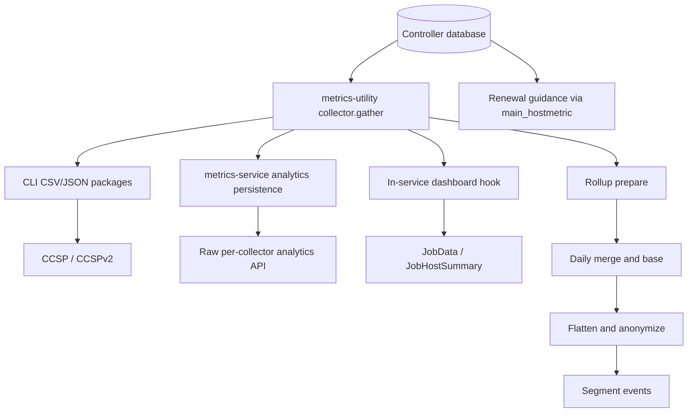
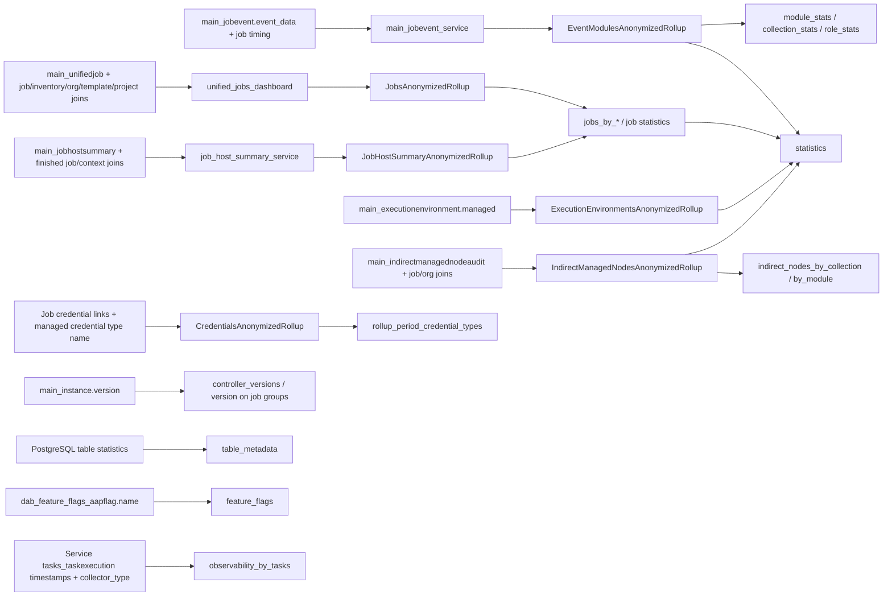
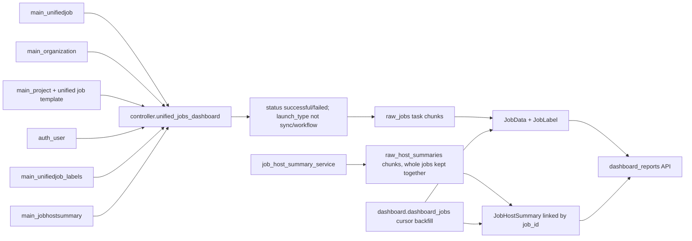

# Collector data lineage

This is a maintainer's map from source columns to the anonymized and dashboard
outputs. It complements the [architecture](architecture.md) and
[collector/partition reference](collectors-and-partitions.md). Names below are
collector output names unless qualified with a database table.

## One collection, several consumers



The branches have different contracts. A column absent from an XLSX report or
Segment payload can still be part of the raw analytics API or dashboard input.
The service's [analytics registry](https://github.com/ansible/metrics-service/blob/devel/apps/analytics/registry.py)
and typed payload schemas are therefore consumers too. Do not remove collector
columns based only on report/rollup usage, or add report usage just to justify a
column. Check all call sites, API schemas, and downstream consumers first.

The library owns SQL and rollup transformations; metrics-service owns schedules,
storage models, hooks, and API exposure. Scheduled collection fans out before
rollup `prepare()`. On-demand analytics collection stores only the raw analytics
payload: it does not refresh dashboard tables or daily rollups.

`CollectorEntry.exclude_columns` in metrics-service withholds fields from
analytics persistence and rollup input, **not** from in-service dashboard hooks.
For example, `launched_by_username` is needed by the dashboard but withheld from
the analytics API. Removing it from this library's SQL would break the local
consumer instead of enforcing the outbound policy.

## Anonymized dependency tree

The final library output is built by
[`anonymize_rollups()`](../metrics_utility/anonymized_rollups/anonymized_rollups.py).
The service supplies the `base(...)["json"]` result for each category. Internal
task keys are not always collector names: service key `unified_jobs` calls
**`controller.unified_jobs_dashboard`**, not `controller.unified_jobs`.



### Jobs and job-host summaries

Sources: [`unified_jobs_dashboard.py`](../metrics_utility/library/collectors/controller/unified_jobs_dashboard.py),
[`job_host_summary_service.py`](../metrics_utility/library/collectors/controller/job_host_summary_service.py).
Transformations: [`JobsAnonymizedRollup`](../metrics_utility/anonymized_rollups/jobs_anonymized_rollup.py),
[`JobHostSummaryAnonymizedRollup`](../metrics_utility/anonymized_rollups/jobhostsummary_anonymized_rollup.py).

Both queries select jobs by `main_unifiedjob.finished` in `[since, until)`.
The job rollup also drops unfinished jobs. This is **not** the dashboard's
successful/failed, non-sync/workflow filter: other finished job types can
contribute to anonymized statistics.

| Final output / field family | Input columns and operation |
| --- | --- |
| `jobs_by_job_type` | `django_content_type.model` → `job_type`; `is_automation` is `job_type == 'job'`. |
| `jobs_by_launch_type` | `main_unifiedjob.launch_type`. |
| `jobs_by_ansible_version`, `rollup_period_ansible_versions` | Nonempty `main_unifiedjob.ansible_version`; grouped or unioned. |
| `jobs_by_controller_version` | All-job aggregate; version supplied by the separate instance-version snapshot. |
| Job `jobs_total`, failed/successful/never-started totals | Distinct `main_unifiedjob.id` per prepared group; boolean `failed`, its inverse, and null `started`. Successful here means `not failed`, not a `status == 'successful'` test. |
| Job duration totals/min/max | `finished - started`; failed/successful totals use `failed`. |
| Job waiting-time totals/min/max | `started - created`. |
| `templates_total`, `inventories_total` | Sets of `unified_job_template_id`, `main_job.inventory_id`, unioned while merging; raw IDs removed at `base()`. |
| `statistics.rollup_period_organizations_total` | Distinct `main_organization.name`, unioned across batches; names removed at `base()`. |
| `statistics.rollup_period_forks_total` | Sum of `main_job.forks`. |
| `rollup_period_scm_types` | Union of nonempty `main_project.scm_type`. |
| `jobs_by_installed_collections_versions` | Expand `main_unifiedjob.installed_collections`, keyed by collection FQCN; group by name/version and use the same job timing/outcome/template/inventory inputs. This measures installed content, not proof it ran. |
| Host `unreachable_total`, `failed_total`, `ok_total`, `skipped_total`, `ignored_total`, `rescued_total` | Sums of `main_jobhostsummary.dark`, `failures`, `ok`, `skipped`, `ignored`, `rescued`; first aggregate by `job_remote_id`, then by job type/launch type/Ansible version. |
| `successful_hosts_total`, `failed_hosts_total`, `unreachable_hosts_total` | One outcome per summary row: default successful, overridden by `failures > 0`, then by `dark > 0`. These are not unique-host counts. |
| `statistics.rollup_period_unique_hosts_total` | Union of non-null `main_jobhostsummary.host_id` (`host_remote_id`) across prepared batches. |
| `statistics.rollup_period_job_host_pairs_total` | Number of input summary rows, summed across batches. |

`flatten_json_report()` matches already-aggregated job and host-summary groups
by `job_type`, `launch_type`, or normalized `ansible_version` (not by job ID at
this stage). Unmatched job groups receive zero host counters. It injects the
first sorted Controller version into those three job groupings and the all-job
version grouping.

The top-level `statistics.rollup_period_jobs_*`, template, and inventory totals
are sums of job-type groups. The successful/failed/unreachable host totals are
sums of host-summary job-type groups. `rollup_period_task_{ok,failed,skipped,unreachable,ignored}_total`
come from the merged job-type counters; `rollup_period_tasks_total` sums those
five counters, **not** `rescued_total`. Do not substitute unique counts over
the whole raw dataset for these existing aggregation rules.

### Events, modules, collections, and roles

Source: [`main_jobevent_service.py`](../metrics_utility/library/collectors/controller/main_jobevent_service.py).
Transformation: [`EventModulesAnonymizedRollup`](../metrics_utility/anonymized_rollups/events_modules_anonymized_rollup.py).

The query selects jobs finished in `[since, until)`, then relevant runner,
warning, and deprecated events in their `job_created` partitions. Job/row
limits can truncate this feed; these statistics describe collected events,
not guaranteed complete Controller totals.

| Final output / field family | Source and conditions |
| --- | --- |
| `module_stats` | `event_data.resolved_action`, falling back to `task_action`, becomes module; FQCN prefix gives collection/source from `collections.json`. |
| `collection_stats` | Same module input grouped by collection/source. |
| `role_stats` | `event_data.resolved_role`, falling back to `main_jobevent.role`; role's own collection determines its source. |
| Per-group `tasks_total` | Distinct `(job_id, event_data.task_uuid)`. |
| Per-group `jobs_total`, successful/failed totals | Distinct `job_id`; outcome from joined `main_unifiedjob.failed`. |
| Per-group job duration/waiting totals, never-started totals | Joined job `created`, `started`, `finished`; count/sum each job once per prepared content group. |
| Per-group `runner_*_total` | Count matching `main_jobevent.event` types. |
| Per-group `ignore_errors_total` | Failed runner variants with `event_data.ignore_errors`, falling back to `res._ansible_ignore_errors`; absent async signals remain false. |
| Per-group `warnings_total`, `deprecations_total` | Presence of nonempty `event_data.res.warnings` / `deprecations` arrays, not their text. |
| Per-group `event_data_size_total` | Sum of `octet_length(main_jobevent.event_data)`. |
| `collection_stats.unique_hosts_total`; per-group `ansible_versions` | Host-ID sets for collection groups and job Ansible-version sets for content groups; raw host IDs removed at `base()`. |
| `statistics.rollup_period_collected_events_total` | Input event count before runner filtering. |
| `statistics.rollup_period_warnings_total`, `rollup_period_deprecations_total` | Counts of standalone `warning` / `deprecated` event rows, distinct from per-group result annotations. |
| `statistics.rollup_period_modules_total` | Distinct module names in the prepared event data. |
| `statistics.rollup_period_playbooks_total` | Number of keys in the merged playbook→modules map; playbook names are not emitted. |

Content statistics use runner events with nonempty module/playbook and non-null
host ID, job ID, and task UUID. Job metadata comes from the job join already in
this collector; the rollup does not add cross-collector joins. Prepared numeric
counts are summed across batches; sets are unioned. `module_stats`,
`collection_stats`, `role_stats` and the event-only top-level statistics are
included only when `collected_events_total > 0`.

### Snapshots, indirect nodes, and service observations

| Final output | Collector and source columns | Transformation / condition |
| --- | --- | --- |
| `statistics.rollup_period_EE_default_total`, `rollup_period_EE_custom_total`, `rollup_period_execution_environments_total` | [`execution_environments`](../metrics_utility/library/collectors/controller/execution_environments.py): `main_executionenvironment.managed` | Count managed vs remaining rows, then sum the two counts. Names/images/credentials are not emitted by this rollup. |
| `rollup_period_credential_types` | [`credentials_service`](../metrics_utility/library/collectors/controller/credentials_service.py): job credential links → `main_credentialtype.name` | Distinct types with `managed = true`, for finished jobs in the window; union names. No credential values are selected. |
| `controller_versions` | [`controller_version_service`](../metrics_utility/library/collectors/controller/controller_version_service.py): `main_instance.version` | Distinct, nonempty versions from enabled control/hybrid instances, sorted by SQL. |
| `table_metadata` | [`table_metadata`](../metrics_utility/library/collectors/controller/table_metadata.py): PostgreSQL catalogs/statistics | `{tablename}_{estimated_row_count,total_size_bytes,table_size_bytes,indexes_size_bytes}`; partitions summed for `main_jobevent`, regular tables for unified jobs and host summaries. Row counts are estimates. |
| `feature_flags` | [`feature_flags_service`](../metrics_utility/library/collectors/controller/feature_flags_service.py): `dab_feature_flags_aapflag.name` | Names with `condition = 'boolean'` and `value = 'True'`; not the service's collection enablement settings. |
| `observability_by_tasks` | [`service.task_executions_service`](../metrics_utility/library/collectors/service/task_executions_service.py): service `tasks_taskexecution.started_at`, `completed_at`, `result_data.collector_type` | Group by collector type: execution count, missing count against expected daily count, and duration sum/min/max. No task parameters/results are emitted. |
| `statistics.rollup_period_indirect_managed_nodes_all_total` | [`main_indirectmanagednodeaudit`](../metrics_utility/library/collectors/controller/main_indirectmanagednodeaudit.py): audit `name` → `host_name` | Union hostnames across prepared groups; raw hostnames removed at `base()`. Requires populated audit data; query window is the related job's `finished`. |
| `indirect_nodes_by_collection`, `indirect_nodes_by_module` | Audit `events` FQCNs plus job's organization name | Prepare by organization/content with hostname sets; `base()` collapses organizations and re-unions hosts by content, emitting content name and `host_count` only. |

Snapshot processors use the latest prepared data rather than adding repeated
snapshots. Indirect-node processing unions names across batches instead.

### Final privacy boundary and transmission

```text
Prepared internal data
├── job/template/inventory/host IDs and organization names
│   └── counts or set sizes; identifiers removed before final output
├── playbook → module sets
│   └── playbook count only
├── module / collection / role names
│   └── public-content allowlist; Custom entries removed
├── installed collection names and indirect content names
│   └── retain only known collections from collections.json
└── numeric aggregates
    └── sanitize NaN / infinity to JSON null
```

Allowlist filtering removes content rows, not all statistics computed from
those rows: top-level collected-event/module counts can still include private
content. The final payload is an explicit projection, not a recursive scrub of
arbitrary collector columns. Adding an output requires its own privacy review.

The service adds `summary_metadata`, aggregate `dashboard_telemetry`,
`leaderboard_telemetry`, and `api_usage_telemetry` after library anonymization.
Their sources are service summary/task/telemetry models and runtime settings,
not additional Controller report columns. See the service's
[anonymization/transmission guide](https://github.com/ansible/metrics-service/blob/devel/docs/anonymization-and-transmission.md)
for enablement and delivery, and
[API usage telemetry](https://github.com/ansible/metrics-service/blob/devel/apps/analytics/middleware.py)
for request counting.

[`StorageSegment`](../metrics_utility/library/storage/segment.py) splits the
payload by top-level key, and large lists by whole items, before sending
`Controller Metrics Daily Rollup` events (`properties.data`). Different keys
can therefore arrive in different chunks. A non-list value is not subdivided.

## Dashboard dependency tree

The service already documents [backfill, hourly hooks, ordering, and enablement](https://github.com/ansible/metrics-service/blob/devel/docs/dashboard-sync.md).
This section adds the source-column view rather than duplicating that lifecycle.



The hourly job hook uses the following projection from
[`unified_jobs_dashboard`](../metrics_utility/library/collectors/controller/unified_jobs_dashboard.py):

| Dashboard input | Source |
| --- | --- |
| `id`, `name`, `unified_job_template_id`, `organization_id`, `started`, `finished`, `status`, `elapsed`, `created`, `modified` | Same-named `main_unifiedjob` fields. |
| `organization_name` | `main_organization.name`, joined on job `organization_id`. |
| `project_id`, `project_name` | `main_job.project_id` → `main_project.unifiedjobtemplate_ptr_id` → `main_unifiedjobtemplate.name`. |
| `launched_by_id`, `launched_by_username` | Job `created_by_id` → `auth_user.id/username`, **only** for manual/relaunch jobs; otherwise null. |
| `label_ids` | Comma-separated `main_unifiedjob_labels.label_id` for this job; becomes local label links. |
| `num_hosts` | Count of `main_jobhostsummary` rows for this job. |

The hourly host-summary hook needs just `id`, `job_remote_id`,
`host_remote_id`, and `host_name` from `job_host_summary_service`; it renames
`host_remote_id` to local `host_id`. A deleted AWX host can have a null ID.
Summary rows link to an existing `JobData.job_id`, not to a local user or host
primary key. Job sync must finish before matching summary sync.

First-start/manual collection uses
[`dashboard/collectors.py`](../metrics_utility/library/collectors/dashboard/collectors.py)
and [`dashboard/queries.py`](../metrics_utility/library/collectors/dashboard/queries.py)
instead: `dashboard_jobs` returns cursor batches with labels and nested host
summaries. It is not an analytics-registry feed. The two paths converge on the
service's dashboard write methods, not on anonymized rollups or analytics JSON.

`launched_by_username` is also used to resolve the requesting user's AWX launcher
ID for leaderboard views: the service user primary key belongs to a different
ID space. This is why a field withheld from analytics remains a live collector
and dashboard dependency.

## Reports and raw analytics

See [report dependency trees](report-lineage.md) for the collect-to-XLSX
pipeline, separate CCSP/CCSPv2/renewal core and default trees, and smaller
trees for each configurable sheet. They distinguish output dependencies from
the current engine/CSV loading gates, and show where optional serial dedup
adds a cross-dataset dependency.

The analytics API exposes the corresponding Controller collectors as raw,
collector-specific payloads, not report dataframes or XLSX files. Collector
variants have different window/column contracts (`job_host_summary` vs
`job_host_summary_service`, for example); they are not interchangeable merely
because they read the same tables. Service-only observations and CLI package
metadata are separate contracts too.

For API envelopes and enabled collectors see
[analytics.md](https://github.com/ansible/metrics-service/blob/devel/docs/analytics.md).
For reconstruction through those feeds, see the service's
[report recipes](https://github.com/ansible/metrics-service/blob/devel/docs/report-recipes.md).
For report aggregation/dedup source see
[`dataframe_engine/`](../metrics_utility/automation_controller_billing/dataframe_engine/),
[`dedup/`](../metrics_utility/automation_controller_billing/dedup/), and
[`report/`](../metrics_utility/automation_controller_billing/report/).
