# Report dependency trees

These diagrams trace the **existing CLI reports**, not a replacement reporting
implementation. They separate the data needed by each report's core/default
output from smaller trees for its configurable sheets. See
[collector data lineage](data-lineage.md) for the parallel anonymized,
dashboard, and raw analytics paths; the service's
[report recipes](https://github.com/ansible/metrics-service/blob/devel/docs/report-recipes.md)
explain reconstruction through the analytics API.

Start with [defaults and required output](#required-versus-default-versus-configurable),
then the [CCSP](#ccsp-core-and-default-output),
[CCSPv2](#ccspv2-core-and-default-output), or
[renewal](#renewal-guidance-core-and-default-output) tree. The
[sheet trees](#smaller-sheet-dependency-trees) and
[loading gates](#current-loading-gates) cover custom configurations.

## Collection to workbook

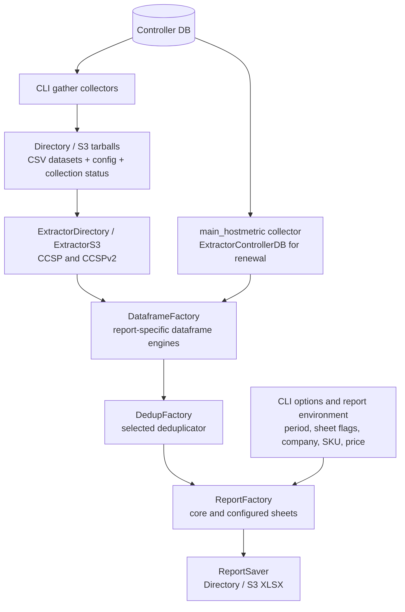

CCSP/CCSPv2 build from collected files, not fresh Controller queries. Renewal
guidance uses `METRICS_UTILITY_SHIP_TARGET=controller_db` to read Controller
directly; its report saver writes to the configured directory. The factory
does not select the extractor merely from the report name.

### Dataset names used in the trees

| Input | Engine / meaning |
| --- | --- |
| `job_host_summary.csv` + `config.json` | `DataframeJobhostSummaryUsage`: reachable direct-host usage, hostname normalization, installation/job/org/template context. |
| `main_indirectmanagednodeaudit.csv` + `config.json` | The same engine's indirect branch: target identity, audit task counts, facts, and content attribution. |
| `main_host.csv` / `main_host_daily.csv` + `config.json` | `DataframeInventoryScope`: accumulated inventory memberships, facts, last automation, and compound serials. |
| `main_jobevent.csv` + `config.json` | `DataframeContentUsage`: module/collection/role usage per host, installation, and job. |
| `data_collection_status.csv` | `DataframeCollectionStatus`: CLI gather status from packages, not a Controller collector. |
| `main_hostmetric` collector result | `DBDataframeHostMetric`: lifecycle metrics joined to current inventory-host facts/variables, then filtered by last automation. |

`config.install_uuid` supplies installation identity to the usage, scope, and
content engines. Company, SKU, price, and address fields instead come from report
environment/`extra_params`; they are not measurements from `config.json`.

## Required versus default versus configurable

The shared default for `METRICS_UTILITY_OPTIONAL_CCSP_REPORT_SHEETS` is:

```text
ccsp_summary,managed_nodes,usage_by_organizations,usage_by_collections,usage_by_roles,usage_by_modules
```

Only the flags implemented by the selected report have an effect on its sheets:

| Flag / output | CCSP | CCSPv2 | Renewal guidance |
| --- | --- | --- | --- |
| Usage Reporting / `ccsp_summary` | Always built; no builder flag check | On by default; configurable | Always built; no builder flag check |
| `managed_nodes` | On by default | On by default | On by default; also enables Deleted Managed nodes and, with `--ephemeral`, ephemeral detail sheets |
| `usage_by_organizations` | No sheet | On by default | No sheet |
| `usage_by_collections` | On by default | On by default | No sheet |
| `usage_by_roles` | On by default | On by default | No sheet |
| `usage_by_modules` | On by default | On by default | No sheet |
| `indirectly_managed_nodes` | Opt-in | Opt-in | No sheet |
| `inventory_scope` | Opt-in | Opt-in | No sheet |
| `jobs` | No sheet | Opt-in | No sheet |
| `managed_nodes_by_organizations` | No sheet | Opt-in; adds per-org tabs and modifies Managed nodes when that sheet is enabled | No sheet |
| `infrastructure_summary` | Warning; skipped | Opt-in | No sheet |
| `data_collection_status` | No sheet | Opt-in | No sheet |

"Always built" describes the builder when a workbook is generated: the command
can still skip an existing report or return without building if every dataframe
is empty. **Default does not mean mandatory**: several default sheets are
configurable, and configurable sheets can share inputs with core output.

Solid arrows below show the normal data path. Dotted arrows describe a
conditional dependency, not an extra collector that always runs.

### CCSP: core and default output

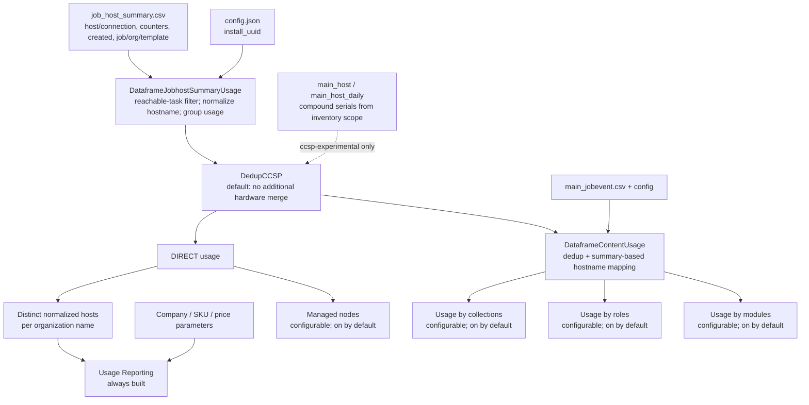

The summary's measured quantity depends on direct summaries and installation
context, not event content or indirect nodes. Price/configuration completes
the commercial presentation. Inventory facts affect that quantity only when
the selected `ccsp-experimental` deduplicator produces a hostname mapping.
Indirect audit data can be loaded by the shared engine under the default
flags, but the CCSP default sheets do not add indirect usage to their outputs.

### CCSPv2: core and default output

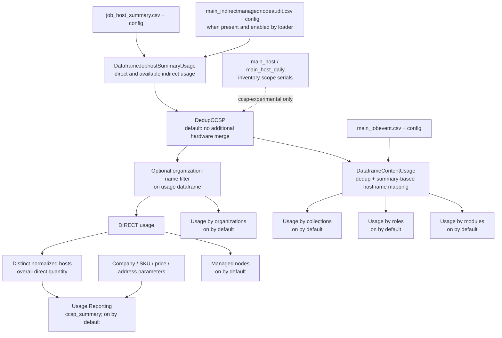

Unlike CCSP's per-org billing rows, CCSPv2's summary uses the global distinct
direct-host quantity after its optional org filter. The filter applies to the
usage dataframe, not the inventory-scope or content dataframe. In Usage by
organizations, job and task totals use all available usage rows, including
indirect rows; separate indirect host-count columns require
`indirectly_managed_nodes`. Indirect nodes never become part of the billing
summary merely because they appear in another sheet.

### Renewal guidance: core and default output

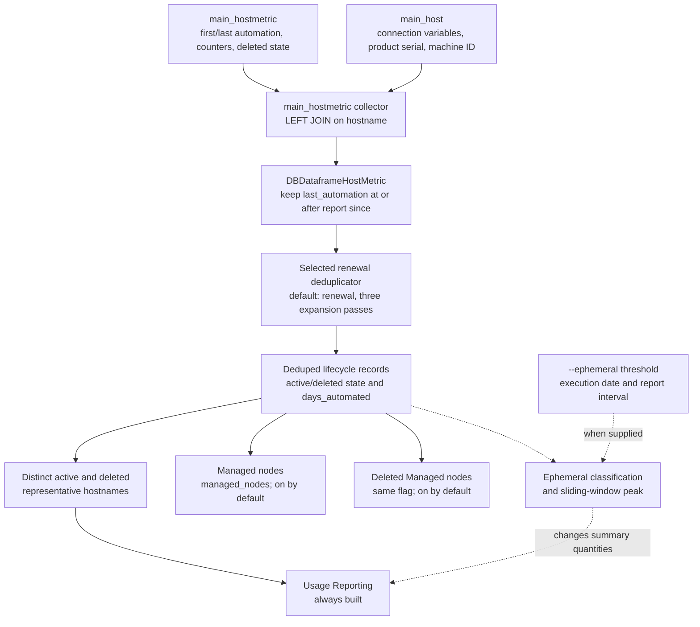

All renewal sheets share this one dataset: there is no event, indirect audit,
tarball, or additional per-sheet collector. The collector's SQL includes
current host matches needed for identity/dedup. The default `renewal` strategy
expands hostname, connection-host, product-serial, and machine-ID matches;
`renewal-hostname` and `renewal-experimental` are alternative strategies, not
additional report inputs.

The CLI collects with the report's `since` and **no upper bound**, then applies
the last-automation filter above. `until` controls the displayed report period
and ephemeral windows, not that lifecycle query. Ephemeral classification also
depends on execution date; see the detail tree below.

## Smaller sheet dependency trees

The trees below describe output dependencies. They are not promises that
disabling a sheet eliminates all loading of its datasets; see
[current loading gates](#current-loading-gates) before choosing a minimal
collection or custom flag set.

### `managed_nodes` — CCSP and CCSPv2

Default-enabled but configurable in both reports.

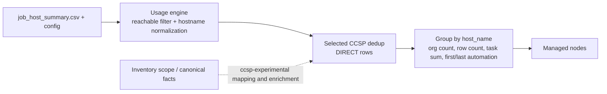

At this final grouping, Job runs counts grouped usage rows, not a fresh
distinct-job query. First/last automation are the min/max summary `created`
timestamps carried by the usage engine. Experimental mode can add canonical
facts, facts, and pre-dedup-name tracking. CCSPv2's
`managed_nodes_by_organizations` mode additionally changes this sheet as shown
in its own tree below.

### `indirectly_managed_nodes` — CCSP and CCSPv2

Opt-in; does not alter either report's direct-only billing quantity.

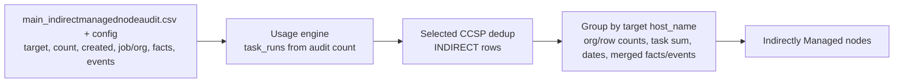

Indirect audit rows do not use the direct reachable-task filter. Their
`events` array supplies content attribution, while `facts` and
`canonical_facts` describe the target. Absent audit data does not establish
that no indirect automation occurred.

### `inventory_scope` — CCSP and CCSPv2

Opt-in; this is inventory membership, not the billable usage set.

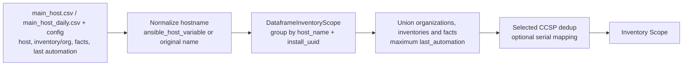

The same scope dataframe supplies compound serials to `ccsp-experimental`
even when the Inventory Scope sheet itself is not selected. Historical
observations and a fresh snapshot need not produce identical scope/facts.

### `jobs` — CCSPv2

Opt-in. Despite its title, this sheet does not require a separate unified-jobs
collector: the summary/audit datasets already contain its job context.

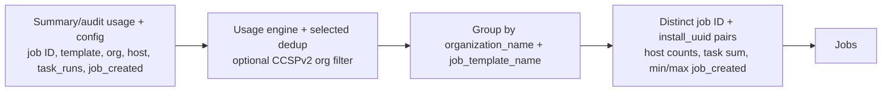

It consumes available direct **and** indirect usage; host counts here are not
filtered to direct nodes.

### `usage_by_organizations` — CCSPv2

Default-enabled but configurable. CCSP has no corresponding sheet.

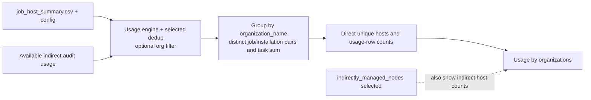

Job/task totals use the combined dataframe independently of whether the
indirect host-count columns are shown. This sheet does not consume event
module/role data, even though its loader flag also enables `main_jobevent.csv`.

### `managed_nodes_by_organizations` — CCSPv2

Opt-in; one flag has two presentation effects.

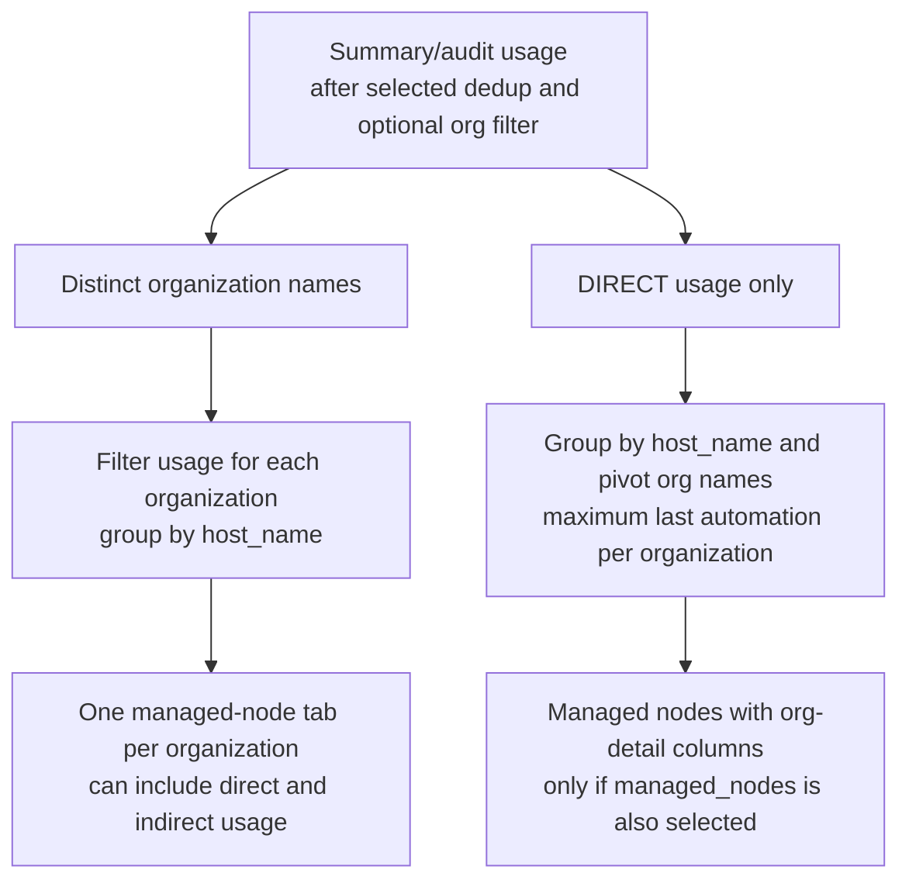

Per-org tabs do not require `managed_nodes` to be selected, but the org-detail
variant of the main Managed nodes sheet does. The separate Indirectly Managed
nodes sheet keeps its normal layout.

### Shared content preparation

The next three sheets are separate flags, each default-enabled in CCSP and
CCSPv2. All use the following prepared content dataframe:

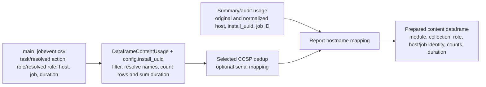

The content engine groups by host/module/collection/role/installation/job.
The report then maps original hostnames using installation/job identity.
These are the CLI `main_jobevent` variant's counts, not interchangeable with
the capped `main_jobevent_service` anonymized feed.

### `usage_by_collections` — CCSP and CCSPv2

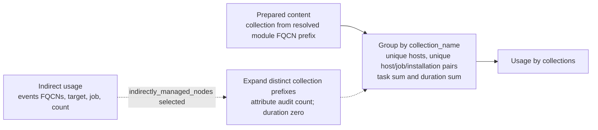

An indirect audit row's entire task count is attributed to **each** of its
distinct collections; it is not a per-collection event count. Only this
content sheet adds indirect collection attribution. The report's content
sheet block is still gated by the content dataframe being non-`None`.

### `usage_by_roles` — CCSP and CCSPv2

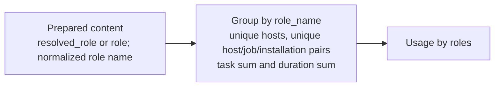

No extra role collector and no indirect-audit expansion are used.

### `usage_by_modules` — CCSP and CCSPv2

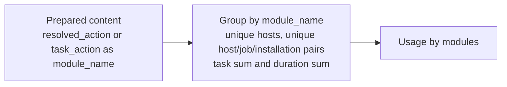

No extra module collector and no indirect-audit expansion are used.

### `infrastructure_summary` — CCSPv2

Opt-in; CCSP logs a warning and skips this sheet.

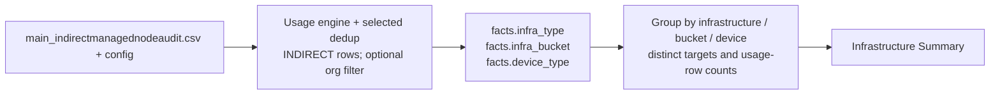

Missing fact values display as `Unknown`; this is not derived from direct
inventory-host hardware facts. This flag enables audit CSV loading directly;
no managed-node sheet is required.

### `data_collection_status` — CCSPv2

Opt-in; no Controller collector or analytics feed substitutes for this input.

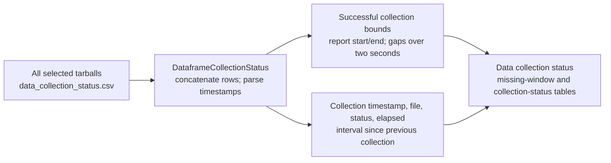

Unlike the dataset-specific engines, this engine visits all tarballs because
status metadata is present in packages named after other collectors. It does
not deduplicate or reconstruct failed gather attempts from job records.

### Renewal `managed_nodes` and `--ephemeral` details

`managed_nodes` is default-enabled. Without `--ephemeral`, it enables the two
detail sheets below; disabling it leaves the core Usage Reporting sheet.

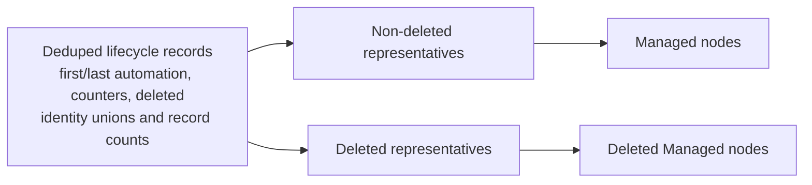

With `--ephemeral=Ndays` (or another supported duration), the same input is
classified by `days_automated <= N` and an execution-date-based first-automation
threshold. Peak usage also needs the requested report interval:

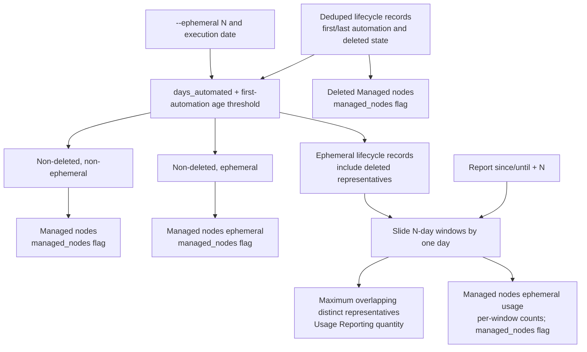

The peak calculation runs for Usage Reporting even if detail sheets are
disabled. `Deleted Managed nodes` continues to include all deleted groups,
not only ephemeral ones. No additional collector is needed for any of these
sheets.

## Current loading gates

Sheet dependencies above and file-loading behavior are deliberately separate.
`DataframeFactory` always creates all CCSP engines (plus collection-status for
CCSPv2), and `DedupCCSP.run()` calls every engine's `build_dataframe()`, even
without experimental dedup. The extractor then applies **both** the engine's
requested collection names and `CSV_SHEETS`:

| File | At least one of these flags enables CSV loading |
| --- | --- |
| `job_host_summary.csv` | `ccsp_summary`, `indirectly_managed_nodes`, `inventory_scope`, `jobs`, `managed_nodes`, `managed_nodes_by_organizations`, `usage_by_organizations` |
| `main_host.csv`, `main_host_daily.csv` | `inventory_scope`, `jobs`, `managed_nodes`, `managed_nodes_by_organizations`, `usage_by_collections`, `usage_by_modules`, `usage_by_roles` |
| `main_indirectmanagednodeaudit.csv` | `indirectly_managed_nodes`, `infrastructure_summary`, `managed_nodes`, `usage_by_organizations` |
| `main_jobevent.csv` | `usage_by_collections`, `usage_by_modules`, `usage_by_organizations`, `usage_by_roles` |
| `data_collection_status.csv` | `data_collection_status` |

`config.json` is requested independently as context. With the stock defaults,
both CCSP variants can load summary, host-scope, audit, and event files even
though Inventory Scope and Indirectly Managed nodes are not rendered.
Creating/invoking an engine does not mean every CSV is enabled, and disabling
one sheet does not imply its input is unused by all other paths.

`jobs` enables its summary CSV input directly, and `infrastructure_summary`
enables its audit CSV input directly. Either sheet can be selected without an
unrelated sheet serving as a workaround to load its required data.

## Source references

- [Command defaults and orchestration](../metrics_utility/management/commands/build_report.py)
- [Extractor factory](../metrics_utility/automation_controller_billing/extract/factory.py) and [CSV sheet gates](../metrics_utility/automation_controller_billing/extract/base.py)
- [Dataframe factory](../metrics_utility/automation_controller_billing/dataframe_engine/factory.py) and [engines](../metrics_utility/automation_controller_billing/dataframe_engine/)
- [Deduplicators](../metrics_utility/automation_controller_billing/dedup/)
- [CCSP builder](../metrics_utility/automation_controller_billing/report/report_ccsp.py), [CCSPv2 builder](../metrics_utility/automation_controller_billing/report/report_ccsp_v2.py), [renewal builder](../metrics_utility/automation_controller_billing/report/report_renewal_guidance.py)
- [Shared sheet aggregation and content/hostname mapping](../metrics_utility/automation_controller_billing/report/base.py)
